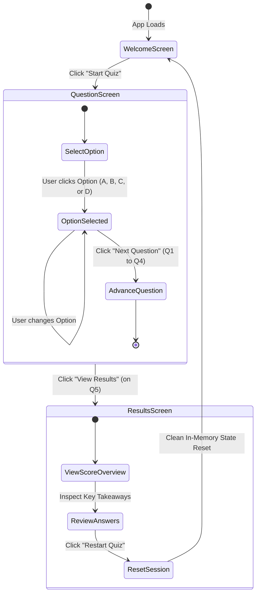

# Agentic Engineering 101 — Interactive Quiz Application

[](https://developer.mozilla.org/en-US/docs/Web/JavaScript)
[](https://developer.mozilla.org/en-US/docs/Glossary/HTML5)
[](https://developer.mozilla.org/en-US/docs/Web/CSS)
[](#technology-stack)
[](#accessibility--usability)
[](LICENSE)

An interactive, responsive educational quiz application designed to test and reinforce fundamental principles of **agentic software engineering**, prompt writing, project instruction files (such as `AGENTS.md`), task decomposition, and code verification.

Built from the ground up with **vanilla web technologies** (HTML5, CSS3, ES6+ JavaScript), this project adheres to strict design constraints: a bespoke **soft pastel blue** palette, lightweight zero-framework architecture, robust state management, and high standards of accessibility.

---

## Table of Contents

- [Overview & Learning Objectives](#overview--learning-objectives)
- [Key Features](#key-features)
- [Visual Design & Color System](#visual-design--color-system)
- [User Experience & Screen Flow](#user-experience--screen-flow)
- [Architecture & File Structure](#architecture--file-structure)
- [State Management & Scoring Engine](#state-management--scoring-engine)
- [Getting Started / Running Locally](#getting-started--running-locally)
- [Customization: Adding New Questions](#customization-adding-new-questions)
- [Accessibility & Usability](#accessibility--usability)
- [Verification & Testing](#verification--testing)
- [Development Journal](#development-journal)
- [Author & Acknowledgments](#author--acknowledgments)

---

## Overview & Learning Objectives

As AI coding agents become integral to modern software development, practitioners must understand how to effectively collaborate with autonomous tools. This application serves as a self-assessment and training module focusing on five core competencies:

1. **Agentic Software Engineering**: Understanding how agents iteratively plan, utilize tools, inspect outputs, and act under human supervision.
2. **Effective Prompt Writing**: Formulating unambiguous, requirement-driven implementation prompts with clear acceptance criteria.
3. **Project Instruction Files**: Leveraging conventions in `AGENTS.md` and repository guidelines to constrain and guide agentic workflows.
4. **Iterative Task Decomposition**: Breaking complex features into modular, verifiable milestones.
5. **Rigorous Code Verification**: Validating AI-generated code through testing, inspection, and manual interaction rather than blind trust.

---

## Key Features

- **Focused 3-Screen Experience**:
  - **Screen A (Welcome)**: Introduces the curriculum, provides quiz metrics (5 questions, beginner level, multiple choice), and clarifies expectations.
  - **Screen B (Quiz / Question)**: Displays one question at a time with real-time progress bar, live counter, question topic badges, and custom styled radio selections.
  - **Screen C (Results & Deep Review)**: Displays performance tier badges, percentage score, breakdown of correct/incorrect counts, and a card-by-card post-quiz review with pedagogical explanations.
- **Pedagogical Answer Review**: Correct answers and detailed explanations are revealed *after* completing the quiz on the results screen. This prevents trial-and-error guessing and promotes genuine learning retention.
- **Adaptive Performance Tiers**:
  - `80% – 100%`: **Strong Understanding** (High mastery of agentic concepts)
  - `40% – 79%`: **Good Progress** (Foundational grasp with actionable areas for review)
  - `0% – 39%`: **Keep Practising** (Encouraging feedback directing learners to study review cards)
- **Zero Page-Reload Restarts**: Complete quiz state can be reset in-memory instantly via the "Restart Quiz" button.
- **Robust Interaction Guards**: Submission locking (`isSubmitting` flag) prevents double-scoring or race conditions from rapid clicking.
- **Zero External Dependencies**: Fast load times, zero build step, and zero third-party scripts.

---

## Visual Design & Color System

The application implements a custom **soft pastel blue** identity tailored for calm, focused learning:

| CSS Variable | Hex Code | Visual Role |
| :--- | :--- | :--- |
| `--bg-main` | `#EAF4FF` | Main canvas background (warm soft blue; eliminates stark white glare) |
| `--bg-secondary` | `#DCEBFA` | Header background, callout info backgrounds |
| `--bg-card` | `#F3F8FF` | Elevated card container surface |
| `--accent-primary` | `#4A78C2` | Primary buttons, active indicators, progress fill, focus rings |
| `--accent-hover` | `#355FA5` | Hover & active state for interactive elements |
| `--text-main` | `#24364B` | High-contrast deep slate text for body and headings |
| `--text-secondary`| `#65758B` | Subdued secondary labels, captions, metadata |
| `--border-color` | `#CBDCF0` | Borders for cards, dividers, unselected options |
| `--color-success` | `#287A59` | Correct answer indicators and success badges |
| `--color-error` | `#B54747` | Incorrect answer indicators and error badges |
| `--blue-tint` | `#E1EDFC` | Option card default backgrounds and meta chips |

### Design Rules Adhered To:
- **No pure white (`#FFFFFF`) page background**: Replaced with soft tinted pastel blues (`#EAF4FF`).
- **No pure black (`#000000`) text**: Replaced with deep slate (`#24364B`) for optimal legibility without harsh contrast.
- **Light Theme Only**: Deliberately configured without dark-mode toggles to maintain brand identity and color harmony.
- **Subtle Micro-Interactions**: Modest corner radii (`6px`–`16px`), restrained box shadows, and smooth 150ms–250ms transitions.

---

## User Experience & Screen Flow



---

## Architecture & File Structure

```
QuizApp/
├── index.html        # Semantic HTML5 markup, screen layouts & accessible landmarks
├── style.css         # Pastel blue design system, component styling & responsive media queries
├── script.js         # Core state management, navigation routing & dynamic DOM rendering
├── questions.js      # Immutable question repository with answers, explanations & topics
├── README.md         # Comprehensive project documentation (this file)
├── Journal.md        # Complete chronological developer journal & engineering timeline
└── .gitignore        # Git ignore specifications
```

### Module Breakdown:

1. **[`index.html`](./index.html)**:
   - Houses three main card containers (`#screen-welcome`, `#screen-question`, `#screen-results`).
   - Uses semantic HTML (`<header>`, `<main>`, `<section>`, `<form>`, `<fieldset>`, `<legend>`, `<footer>`).
   - Implements ARIA live regions (`aria-live="polite"`), progress bar attributes (`aria-valuenow`, `aria-valuemin`, `aria-valuemax`), and accessible radio form fields.

2. **[`style.css`](./style.css)**:
   - Built with CSS Custom Properties (CSS variables) for streamlined theming.
   - Fluid typography and responsive grid/flexbox layouts.
   - Comprehensive media queries for tablet and mobile screens (`max-width: 640px` and `max-width: 480px`).
   - Native support for `@media (prefers-reduced-motion: reduce)`.

3. **[`questions.js`](./questions.js)**:
   - Clean, decoupled JavaScript array (`QUIZ_QUESTIONS`) containing 5 question objects.
   - Runtime immutability enforced using `Object.freeze()`.
   - Each entry contains `id`, `question`, `options`, `correctIndex`, `explanation`, `difficulty`, and `topic`.

4. **[`script.js`](./script.js)**:
   - Encapsulated within an Immediately Invoked Function Expression (IIFE) with `'use strict'` to eliminate global scope pollution.
   - Centralized reactive state store (`state`).
   - DOM elements cache for performant DOM queries.
   - Single-direction screen switching with automatic focus management (`showScreen()`).
   - Accurate score calculation and review card generation (`calculateResults()`, `renderResults()`).
   - Cross-Site Scripting (XSS) prevention via helper `escapeHtml()`.

---

## State Management & Scoring Engine

### 1. State Store
The application maintains state in a single, predictable JavaScript object:

```javascript
const state = {
  currentQuestionIndex: 0, // 0-based index of active question
  selectedAnswers: {},     // Map: { [questionIndex]: selectedOptionIndex }
  isSubmitting: false,     // Concurrency lock preventing double-submissions
  status: 'welcome',       // Screen status: 'welcome' | 'in_progress' | 'completed'
  results: null            // Computed score metrics and review items
};
```

### 2. Scoring Algorithm
The score is calculated strictly upon advancing past the final question by evaluating `state.selectedAnswers` against the immutable `QUIZ_QUESTIONS[i].correctIndex`:

$$\text{Percentage} = \text{round}\left( \frac{\text{Correct Count}}{\text{Total Questions}} \times 100 \right)$$

- Multiple clicks on options do not increment any score counters.
- Changing an answer before pressing "Next Question" cleanly updates `state.selectedAnswers[currentQuestionIndex]`.
- Points cannot be accumulated or double-counted.

---

## Getting Started / Running Locally

Because this application is built without complex dependencies or build steps, it can be run immediately in any modern web browser.

### Option 1: Direct File Opening (Simplest)
Double-click `index.html` or open it directly in your browser:
```bash
# On Windows PowerShell
Invoke-Item .\index.html
```

### Option 2: VS Code Live Server
1. Open the `QuizApp` folder in Visual Studio Code.
2. Install the **Live Server** extension (by Ritwick Dey).
3. Right-click `index.html` and click **"Open with Live Server"**.

### Option 3: Python Built-in HTTP Server
If Python is installed on your system:
```bash
# In the project root directory:
python -m http.server 8000
```
Then navigate to `http://localhost:8000` in your browser.

### Option 4: Node.js `npx serve`
```bash
npx serve .
```

---

## Customization: Adding New Questions

To expand or update the quiz curriculum, edit [`questions.js`](./questions.js). Simply append a new question object to the `QUIZ_QUESTIONS` array before the `Object.freeze()` call:

```javascript
{
  id: "q6",
  question: "Why should coding agents operate with human-in-the-loop oversight?",
  options: [
    "Because agents never make syntax errors.",
    "To ensure generated changes align with project intentions, architecture, and safety constraints.",
    "Because AI models cannot execute terminal commands.",
    "To prevent agents from reading git commit history."
  ],
  correctIndex: 1, // 0-indexed: Option B is correct
  explanation: "Human oversight ensures agents remain aligned with business logic and architectural constraints, catching edge cases that automated tools may overlook.",
  difficulty: "Beginner",
  topic: "Human-in-the-Loop Verification"
}
```

The application dynamically computes total question counts, progress bar milestones, and scoring percentages based on `QUIZ_QUESTIONS.length`.

---

## Accessibility & Usability

The application was designed to meet **WCAG 2.1 AA** standards:

- **Keyboard Navigation**:
  - All interactive elements (`<button>`, `<input type="radio">`, `.option-card`) are fully navigable via `Tab`.
  - Radio options can be triggered using both `Space` and `Enter`.
  - Distinct, high-contrast `:focus-visible` rings (`2px solid #4A78C2`) ensure clear focus tracking.
- **Screen Reader Support**:
  - Questions are marked up inside a semantic `<fieldset>` with an accessible `<legend>`.
  - Dynamic question updates announce progress via `aria-live="polite"`.
  - The progress bar utilizes `role="progressbar"` with `aria-valuemin`, `aria-valuemax`, and `aria-valuenow`.
  - Screen transitions programmatically shift keyboard focus to the main heading (`<h1>` / `<h2>`) via `tabindex="-1"`.
- **Text & Visual Redundancy**:
  - Correct and incorrect indicators never rely solely on color. Review cards include explicit text labels (`Correct` / `Incorrect`) alongside unicode checkmarks and crosses (`✓` / `✗`).
- **Reduced Motion Support**:
  - Incorporates `@media (prefers-reduced-motion: reduce)` to disable transitions for users sensitive to motion.

---

## Verification & Testing

Every interaction has been verified across multiple browsers (Chrome, Edge, Firefox):

| Acceptance Test | Condition Tested | Result |
| :--- | :--- | :---: |
| **Initial Load** | Welcome card displays with accurate metadata and start button | Passed |
| **Progress Tracking** | Progress bar scales accurately across questions ($20\%, 40\%, \dots, 100\%$) | Passed |
| **Button State Guard** | "Next Question" remains disabled until an option is selected | Passed |
| **Single Selection** | Only one option can be selected per question | Passed |
| **Option Switching** | User can switch choices freely before clicking next | Passed |
| **Dynamic Button Label** | Changes to "View Results" on question 5 of 5 | Passed |
| **Score Computation** | Perfect run yields 5/5 (100%), imperfect run yields exact correct counts | Passed |
| **Tier Attribution** | Accurately assigns "Strong Understanding", "Good Progress", or "Keep Practising" | Passed |
| **Review Cards** | Displays user's answer, correct answer, and pedagogical explanation | Passed |
| **In-Memory Reset** | "Restart Quiz" resets counters, state, and UI back to the welcome screen | Passed |
| **Rapid-Click Debounce** | `isSubmitting` prevents duplicate question advancement | Passed |

---

## Development Journal

For a detailed chronicle of every decision, challenge, architecture review, and timestamped step taken during the construction of this project, refer to the [**`Journal.md`**](./Journal.md) document.

---

## Author & Acknowledgments

- **Developer**: [Tunde Awogbami](https://github.com/TundeAwogbami)
- **Repository**: [https://github.com/TundeAwogbami/QuizApp](https://github.com/TundeAwogbami/QuizApp)
- **Design Inspiration**: Light Pastel Blue Design Guidelines from the Agentic Engineering Brief.
- **License**: MIT License — feel free to adapt and expand this application for educational purposes.
